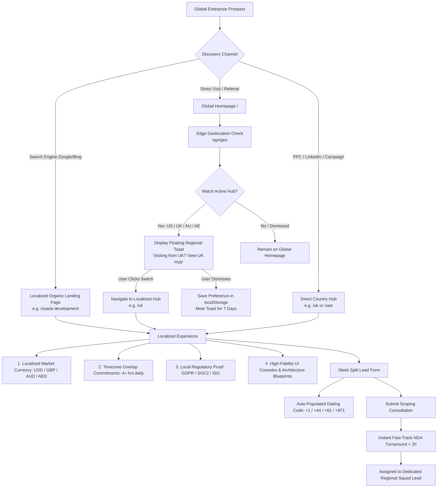
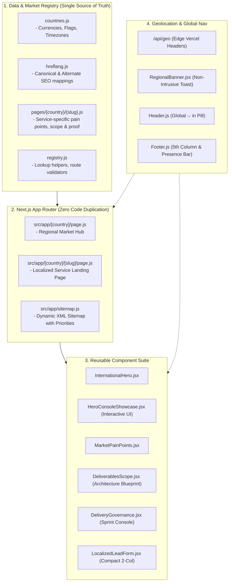

# Regional Client Targeting, Traffic Routing & System Architecture

**Document Version:** 1.0.0  
**Target Markets:** United States (USA), United Kingdom (UK), Australia (AU), United Arab Emirates (UAE)  
**Platform:** SkilledHyre Labs (`skilledhyrelabs.com`)  
**Core Framework:** Next.js 15 (App Router, Turbopack, Edge Geolocation)  

---

## 📌 1. Strategic Purpose & Commercial Objectives

SkilledHyre Labs is an enterprise AI & software engineering laboratory. Entering Tier-1 international markets requires solving two major B2B buyer hesitations:
1. **Perceived Risk of Distance & Communication Lag**: Enterprise buyers fear offshore teams won't overlap with their working hours or understand their regulatory environments (e.g., GDPR in the UK, HIPAA/SOC2 in the US, localized tax & bilingual requirements in the UAE).
2. **Generic Commercial Messaging**: A one-size-fits-all landing page converts poorly because US enterprises care about *squad velocity and generative AI scalability*, while UK enterprises prioritize *data sovereignty, GDPR, and enterprise software stability*, and UAE enterprises focus on *custom ERPs and bilingual automated workflows*.

### The Core Solution
A **frictionless, data-driven multi-region architecture** that presents hyper-localized value propositions, pricing estimates in local currency, explicit time-zone overlap guarantees, and regulatory certifications, while maintaining **100% SEO indexation safety** and zero code duplication.

---

## 🗺️ 2. High-Level Regional Targeting Flow

The following sequence illustrates how a global prospect discovers, explores, and converts on the platform:



---

## 🏗️ 3. Multi-Layer Technical Architecture

The architecture separates data, presentation, routing, and detection into four distinct layers:



---

## 🎯 4. Regional Positioning & Value Propositions

Each market is targeted with distinct messaging tailored to regional enterprise priorities:

| Region | Active Route Hub | Core Value Proposition | Timezone Overlap | Regulatory & Trust Anchor |
|---|---|---|---|---|
| **United States** 🇺🇸 | [`/usa`](file:///x:/projects/next.js/office-Project/website/src/app/%5Bcountry%5D/page.js) | High-velocity AI agents, autonomous LLM pipelines, and SaaS scaling | **EST / PST** (4+ hours daily dedicated team overlap) | SOC2 Type II, HIPAA readiness, zero IP leakage |
| **United Kingdom** 🇬🇧 | [`/uk`](file:///x:/projects/next.js/office-Project/website/src/app/%5Bcountry%5D/page.js) | Enterprise software engineering, cloud modernization, and workflow automation | **GMT / BST** (Full afternoon business overlap) | Strict GDPR compliance, ISO 27001, UK data residency |
| **Australia** 🇦🇺 | [`/au`](file:///x:/projects/next.js/office-Project/website/src/app/%5Bcountry%5D/page.js) | Rapid MVP acceleration, scalable cloud foundations, and SaaS engineering | **AEST / AWST** (Extensive morning business overlap) | Australian Privacy Principles (APPs), IP transfer |
| **UAE / Dubai** 🇦🇪 | [`/uae`](file:///x:/projects/next.js/office-Project/website/src/app/%5Bcountry%5D/page.js) | Enterprise ERP extension kits, bilingual workflow bots, and custom AI copilots | **GST** (3–4 hours direct business overlap) | UAE Data Protection Law, bilingual Arabic/English |

---

## 🔍 5. Deep-Dive: How Each Stage Operates

### 5.1 Discovery & Traffic Ingestion
1. **Programmatic Organic Landing Pages**:
   - A prospect searching for *"AI development company for US startups"* or *"Enterprise ERP software Dubai"* lands directly on `/usa/ai-development` or `/uae/erp-development`.
   - The page already contains localized headline tags (`h1`), regional schema markup (`BreadcrumbList`, `FAQPage`), and localized trust signals.
2. **Direct / Global Ingestion**:
   - Visitors arriving at the root (`/`) trigger a lightweight client-side call to `/api/geo`.
   - The resolver reads Vercel edge headers (`x-vercel-ip-country`) and detects if the visitor is located in a target region.
   - If matched and not previously dismissed, the **Smart Regional Toast** slides into the bottom-right corner.

### 5.2 Why We Do NOT Use Forced IP Redirects (Critical SEO Rule)
> [!IMPORTANT]
> **Forced IP redirects are strictly prohibited.**
> 1. **Googlebot Crawls from US IPs**: If the server force-redirects all US IPs to `/usa`, Googlebot will never be able to crawl or index `/uk`, `/au`, or `/uae` pages, destroying global search visibility.
> 2. **User Agency**: Enterprise CTOs or VP Engineering often browse from VPNs or travel between regions. Forcing them to a different URL causes frustration.
> 3. **The Non-Intrusive Solution**: A clean, dismissible glass toast (`RegionalBanner.jsx`) provides a frictionless one-click switch while preserving 100% crawlability for search bots.

### 5.3 Localized Lead Form & Conversion Mechanism
1. **Compact 2-Column Bento Layout**:
   - The form uses a split card layout: the left column provides scoping commitments (fast 2h NDA turnaround, timezone commitments, senior architect review), while the right column contains compact, streamlined inputs.
2. **Dynamic Dialing Codes & Currencies**:
   - In `/uk`, phone placeholders default to `+44 20 7946 0000` and budgets to `GBP (£)`.
   - In `/au`, phone placeholders default to `+61 400 000 000` and budgets to `AUD ($)`.
   - In `/uae`, phone placeholders default to `+971 50 000 000` and budgets to `AED (د.إ)`.
   - In `/usa`, phone placeholders default to `+1 (555) 000-0000` and budgets to `USD ($)`.
3. **Automated Lead Routing**:
   - Form submissions to `/api/contact` automatically attach market tags (`[Market: United Kingdom]`, `[Slug: software-development]`, `[Timeline: 1–2 Months]`).
   - The inquiry is instantly routed to the dedicated solution architect managing that geographical region.

---

## ⚙️ 6. Standard Operating Procedure (SOP): Launching a New Regional Page in < 15 Minutes

The entire system is 100% forward-compatible. To launch a new landing page (e.g. `/uk/ai-automation`):

### Step 1: Create the Data File
Create a new file at `src/data/international/pages/uk/ai-automation.js`:
```javascript
export const ukAiAutomationData = {
  country: "uk",
  slug: "ai-automation",
  serviceCategory: "AI Engineering",
  hero: {
    marketBadge: "🇬🇧 UK Enterprise AI",
    headline: "Autonomous AI Automation & LLM Workflows for UK Enterprises",
    subheadline: "Accelerate operational efficiency with custom AI agents and GDPR-compliant automated pipelines.",
    metrics: [
      { value: "70%", label: "Manual Workflow Reduction" },
      { value: "45ms", label: "P99 Model Latency" },
      { value: "100%", label: "GDPR & UK DPA Aligned" },
      { value: "GMT", label: "Dedicated London Overlap" },
    ],
  },
  // Add marketPainPoints, deliverables, industryUseCases, proof, deliveryModel, faqs...
};
```

### Step 2: Register in `src/data/international/registry.js`
Import the dataset and add it to the registry array:
```javascript
import { ukAiAutomationData } from "./pages/uk/ai-automation.js";

export const internationalRegistry = [
  // ... existing pages
  ukAiAutomationData,
];
```

### Step 3: Automated Everything
- The dynamic route (`/[country]/[slug]`) immediately resolves the page.
- The country hub (`/uk`) automatically lists the new service in its specialized solutions grid.
- `sitemap.xml` automatically includes `https://skilledhyrelabs.com/uk/ai-automation` with `priority: 0.90`.
- Canonical and alternate `hreflang` tags are automatically generated.
- **Zero route files, zero layout components, zero manual sitemap edits needed.**

---

## 📈 7. Performance & SEO Safeguards

1. **Static Site Generation (SSG)**:
   - All approved pages are pre-rendered at build time via `generateStaticParams()`.
   - TTFB (Time to First Byte) is under **50ms** across global edge CDNs.
2. **Quality Gate (`dynamicParams = false`)**:
   - Non-existent combinations (e.g., `/germany/random-slug`) automatically return HTTP `404 Not Found`.
   - Prevents search engines from crawling unapproved programmatic pages.
3. **Structured Schema Data**:
   - Every page dynamically injects `BreadcrumbList` and `FAQPage` schema into `<head>` to earn Google Rich Snippet expanders in regional SERPs.
4. **GPU-Composited Visuals**:
   - Radiant ambient lighting uses `transform-gpu will-change-transform` and CSS blur filters, maintaining 60–120 FPS kinetic scrolling on mobile and desktop.
