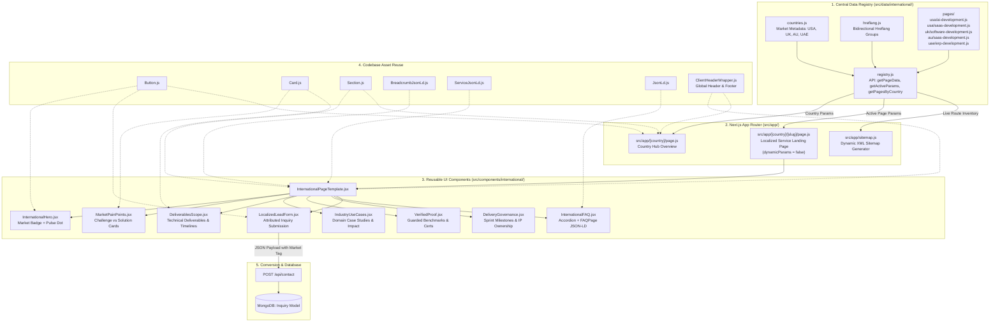
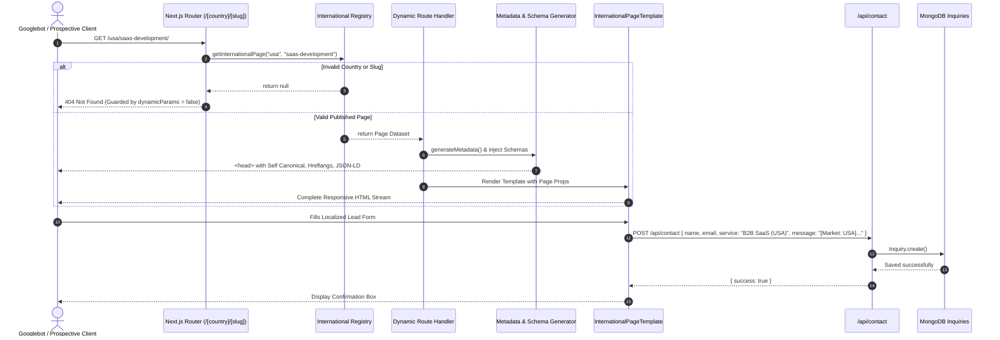

# SkilledHyre Labs — International Landing Page System Documentation

**System Title:** Reusable Country × Service × Industry Architecture  
**Domain:** `https://skilledhyrelabs.com`  
**Framework:** Next.js 15 (App Router), React 19, Tailwind CSS v4, MongoDB  
**Status:** Live & Implemented (Phases 1 & 2 Complete)  

---

## 1. Executive Overview

The **International Landing Page System** enables SkilledHyre Labs to publish hyper-localized, high-converting international landing pages without duplicating React components or writing boilerplate Next.js route handlers.

### Key Capabilities:
* **Single Reusable UI Engine**: A modular layout orchestrates 8 specialized UI sections.
* **100% Data-Driven**: Every page is defined as a pure JavaScript data contract.
* **Zero Crawler Traps (`dynamicParams = false`)**: Unverified or unapproved combinations cleanly return a **404**, safeguarding domain authority against programmatic thin-content penalties.
* **Core Web Vitals & Speed**: 100% pre-rendered at build time via `generateStaticParams()`.
* **Technical SEO**: Self-referencing canonicals, reciprocal `hreflang` alternates, Schema.org graphs (`Service`, `FAQPage`, `BreadcrumbList`), and dynamic XML sitemap integration.
* **Closed-Loop Lead Attribution**: Conversion inquiries are captured directly into MongoDB via `/api/contact`, auto-tagged with market country and service intent.

---

## 2. End-to-End System Architecture Diagram



---

## 3. Request Lifecycle & Routing Flow



---

## 4. Codebase File Structure & Responsibilities

```
src/
├── app/
│   ├── [country]/
│   │   ├── page.js                    # Country Hub Route (e.g. /usa/, /uk/, /au/, /uae/)
│   │   └── [slug]/
│   │       └── page.js                # Core Service Landing Route (e.g. /usa/ai-development/)
│   └── sitemap.js                     # Auto-includes active international hubs & landing pages
│
├── data/
│   └── international/
│       ├── countries.js               # Metadata for USA, UK, Australia, UAE
│       ├── hreflang.js                # Bidirectional alternate link definitions
│       ├── registry.js                # Single source of truth lookup API
│       └── pages/
│           ├── usa/
│           │   ├── ai-development.js  # US Enterprise AI & LLMs
│           │   └── saas-development.js# US B2B SaaS & MVPs
│           ├── uk/
│           │   └── software-development.js # UK Bespoke Software & Modernization
│           ├── au/
│           │   └── saas-development.js# Australia SaaS & Discovery
│           └── uae/
│               └── erp-development.js # UAE Custom ERP & Workflow Automation
│
└── components/
    └── international/
        ├── InternationalPageTemplate.jsx # Unified page layout orchestrator
        ├── InternationalHero.jsx         # Hero section with market badge & stats
        ├── MarketPainPoints.jsx          # Problem vs Solution comparison grid
        ├── DeliverablesScope.jsx         # Technical capabilities & deliverables
        ├── IndustryUseCases.jsx          # Sector-specific architectures & outcomes
        ├── VerifiedProof.jsx             # Benchmarks & certifications guard
        ├── DeliveryGovernance.jsx        # Milestones, NDA & IP transfer badges
        ├── InternationalFAQ.jsx          # Interactive accordion + FAQPage Schema
        └── LocalizedLeadForm.jsx         # Lead capture form with MongoDB attribution
```

---

## 5. Live Page Inventory (Phases 1 & 2)

### A. Country Hubs
* `https://skilledhyrelabs.com/usa/` — United States Market Hub
* `https://skilledhyrelabs.com/uk/` — United Kingdom Market Hub
* `https://skilledhyrelabs.com/au/` — Australia Market Hub
* `https://skilledhyrelabs.com/uae/` — UAE / Dubai Market Hub

### B. Specialized Service Landing Pages
| URL Path | Target Market | Service Category | Hreflang Reciprocity |
| :--- | :---: | :--- | :--- |
| `/usa/ai-development/` | 🇺🇸 USA | Enterprise AI Agent & LLM Engineering | `en-US` ⟷ `en-GB`, `en-AE`, `x-default` |
| `/usa/saas-development/` | 🇺🇸 USA | B2B SaaS & MVP Engineering | `en-US` ⟷ `en-AU` (`/au/saas-development`) |
| `/uk/software-development/` | 🇬🇧 UK | Bespoke Software & Modernization | `en-GB` ⟷ `x-default` |
| `/au/saas-development/` | 🇦🇺 Australia | SaaS Discovery & MVP Builds | `en-AU` ⟷ `en-US` (`/usa/saas-development`) |
| `/uae/erp-development/` | 🇦🇪 UAE | Custom ERP & Workflow Automation | `en-AE` ⟷ `x-default` |

---

## 6. Technical SEO Specifications

### 1. Dynamic Canonical URLs
Every page generates its self-referencing canonical URL dynamically:
```html
<link rel="canonical" href="https://skilledhyrelabs.com/usa/saas-development" />
```

### 2. Reciprocal Hreflang Network
Pages targeting identical services across regions generate mutual alternate links:
```html
<!-- On /usa/saas-development/ -->
<link rel="alternate" hreflang="en-US" href="https://skilledhyrelabs.com/usa/saas-development" />
<link rel="alternate" hreflang="en-AU" href="https://skilledhyrelabs.com/au/saas-development" />
<link rel="alternate" hreflang="x-default" href="https://skilledhyrelabs.com/services/product-engineering" />

<!-- On /au/saas-development/ -->
<link rel="alternate" hreflang="en-US" href="https://skilledhyrelabs.com/usa/saas-development" />
<link rel="alternate" hreflang="en-AU" href="https://skilledhyrelabs.com/au/saas-development" />
<link rel="alternate" hreflang="x-default" href="https://skilledhyrelabs.com/services/product-engineering" />
```

### 3. Structured Data (Schema.org JSON-LD)
* **`BreadcrumbList`**: Automatically constructed (`Home > [Country Name] > [Page Title]`).
* **`Service`**: Declares provider (`SkilledHyre Labs`), `areaServed` (`Country`), and `serviceType`.
* **`FAQPage`**: Injected directly into the DOM from the localized FAQs, enabling rich snippet accordion expansion in search results.

---

## 7. How to Add a New Page in 5 Minutes (Developer SOP)

To add any future page (e.g. `/au/cloud-engineering/` or `/uk/ai-automation/`):

### Step 1: Create the Data File
Create `src/data/international/pages/au/cloud-engineering.js`:
```javascript
export const auCloudEngineering = {
  country: "au",
  slug: "cloud-engineering",
  serviceCategory: "Cloud Architecture & DevOps",
  published: true,
  seo: { ... },
  hero: { ... },
  marketPainPoints: { ... },
  servicesDeliverables: { ... },
  useCases: [ ... ],
  proof: { ... },
  deliveryModel: { ... },
  faqs: [ ... ],
  leadCapture: { ... },
};
```

### Step 2: Register in `registry.js`
In `src/data/international/registry.js`:
```javascript
import { auCloudEngineering } from "./pages/au/cloud-engineering.js";

const allPages = [
  // ... existing pages
  auCloudEngineering,
];
```

### Step 3: Done!
* Next.js **automatically** creates the route `/au/cloud-engineering/`.
* The Australian Hub (`/au/`) **automatically** lists Cloud Engineering.
* `sitemap.js` **automatically** includes the new URL.
* Schemas, canonicals, and lead capture work out-of-the-box with **zero UI coding**.
